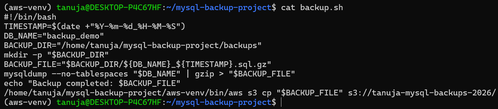
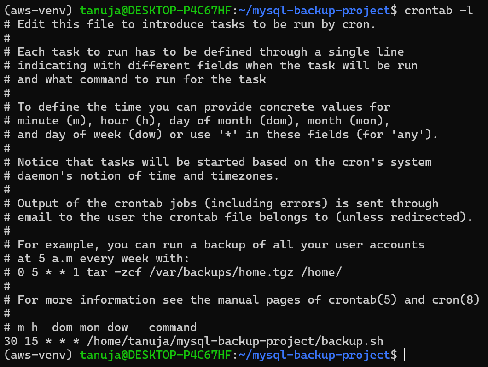
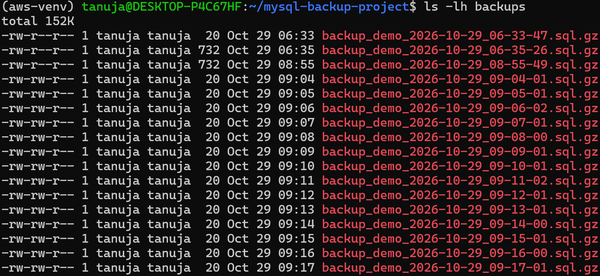
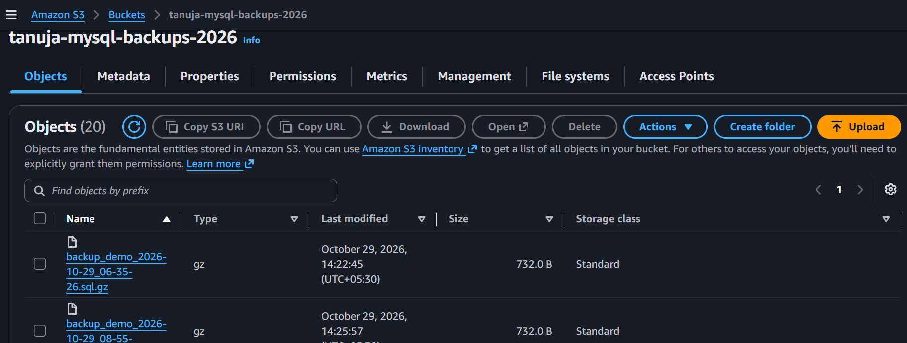
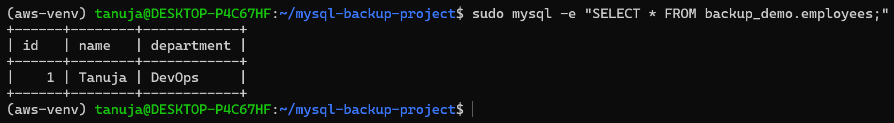

# Automated MySQL Backup & Cloud Archival Pipeline

## Project Overview
This project automates MySQL database backups, compresses them, and uploads them to Amazon S3 for cloud storage.

## Technologies Used
- Linux (Ubuntu)
- MySQL
- Bash Scripting
- Amazon S3
- AWS CLI
- Cron

## Features
- Automated MySQL database backups using `mysqldump`
- Backup compression using `gzip`
- Upload of backups to Amazon S3
- Scheduled execution using cron
- Backup integrity verification
- Database restore testing

## How It Works
1. A cron job executes the backup script on a schedule.
2. `mysqldump` exports the MySQL database.
3. `gzip` compresses the backup file.
4. AWS CLI uploads the compressed backup to Amazon S3.

## Backup Script
The `backup.sh` script performs the database backup, compression, and S3 upload.

## S3 Storage
Backup files are stored in the S3 bucket:
`tanuja-mysql-backups-2026`

## Verification
- Verified compressed backup integrity.
- Restored a backup into a test database.
- Confirmed that the `employees` table and its data were restored successfully.

## Repository Contents
- `backup.sh` — Automated backup and upload script
- `.gitignore` — Excludes the virtual environment and backup files from Git

## Disclaimer
This is a learning project created to practice Linux administration, MySQL backup and recovery, Bash scripting, cron scheduling, and AWS S3.

## Screenshots

### 1. Backup Script

### 2. Automated Cron Schedule

### 3. Local Backup Files

### 4. Amazon S3 Backup Files

### 5. Restore Verification

